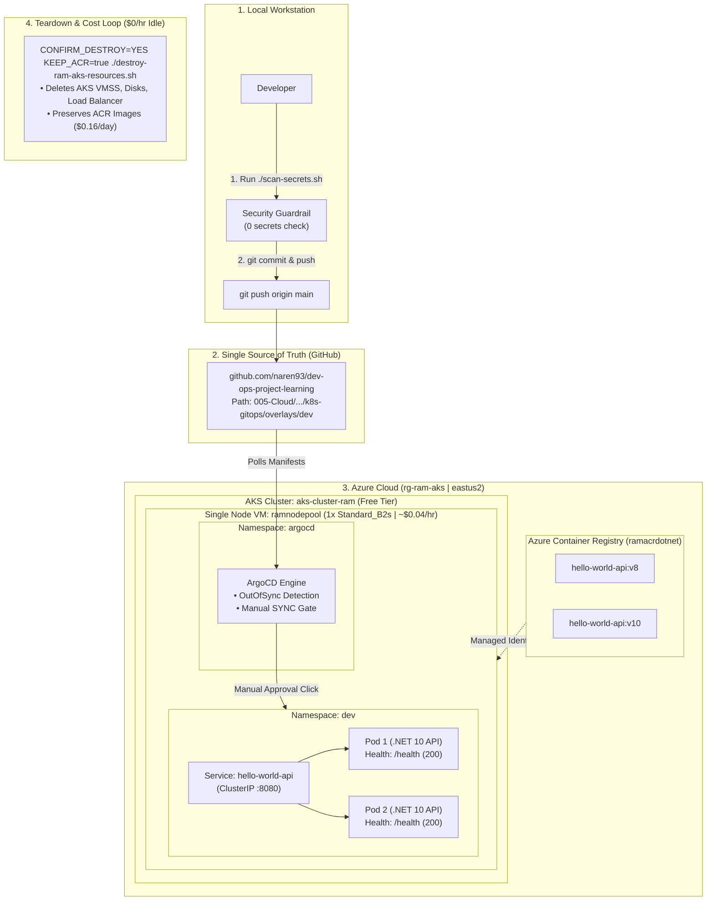

# High-Level Architecture Overview: AKS Lean Lab & GitOps Pipeline

**Workspace:** `dev-ops-project-learning/005-Cloud/kubernetes/kubernetes-aks`  
**Git Repository:** `https://github.com/naren93/dev-ops-project-learning.git`  
**Subscription:** `<AZURE_SUBSCRIPTION>` (`<AZURE_SUBSCRIPTION_ID>`)  
**Resource Group:** `rg-ram-aks` (`eastus2`)  
**Cluster:** `aks-cluster-ram` (Free tier, single-node `ramnodepool`)  

---

## 1. Architecture Diagram

---

## 2. Key Architectural Pillars

| Component | Technology | Responsibility | Why It's Built This Way |
| :--- | :--- | :--- | :--- |
| **Cloud Builds** | Azure ACR Tasks (`az acr build`) | Compiles .NET 8 & .NET 10 Docker images in Azure cloud | Eliminates host Docker dependency; idempotent check skips rebuilding existing tags. |
| **Compute Node** | AKS Single Node (`Standard_B2s`, Free tier) | Hosts system control plane agents + application workloads | Avoids multi-VM billing by consolidating everything onto 1 node (~$0.04/hr). |
| **GitOps Engine** | ArgoCD in `argocd` namespace | Reconciles cluster state with GitHub repository | Single source of truth in Git; provides audit trail and instant rollbacks. |
| **Approval Gate** | ArgoCD Manual Sync (`automated:` disabled) | Requires human review before applying changes | Commits transition app to `OutOfSync`; operator inspects line diff (`App Diff`) and approves. |
| **High Availability** | Deployment (`replicas: 2`, `RollingUpdate`) | Zero-downtime rolling updates | `maxUnavailable: 50%` ensures at least 1 healthy pod serves traffic at all times. |
| **Health Checks** | Readiness & Liveness Probes (`/health`) | Verifies pod responsiveness before cutover | Prevents traffic from hitting uninitialized pods; old pods only terminate after new pods pass. |
| **Pre-Commit Security** | `./scan-secrets.sh` (Python regex engine) | Prevents committing credentials or Subscription IDs | Pre-commit guardrail protects secrets before any push to remote GitHub. |
| **Cost Teardown** | `./destroy-ram-aks-resources.sh` | Destroys compute while keeping images in ACR | Keeps idle compute bills at **$0/hour** while preserving images for 3-minute spin-up. |

---

## 3. End-to-End Workflow

1. **Local Authoring:** Developer updates Kubernetes configuration (e.g., changes image tag to `v10` in [`k8s-gitops/overlays/dev/kustomization.yaml`](file:///Users/rsubramanian/Documents/My_Folder/ProgsFolio/github-saves/dev-ops-project-learning/005-Cloud/kubernetes/kubernetes-aks/k8s-gitops/overlays/dev/kustomization.yaml)).
2. **Security Gate:** Run `./scan-secrets.sh` to ensure zero sensitive credentials or Azure IDs are staged.
3. **Push to Git:** Developer runs `git commit` and `git push origin main`.
4. **GitOps Detection:** ArgoCD polls GitHub, detects the new commit hash, and marks the app as **`OutOfSync` (Yellow)**.
5. **Operator Approval:** Operator reviews the visual diff in ArgoCD UI (`https://localhost:8443`) and clicks **`SYNC`**.
6. **Zero-Downtime Rollout:** Kubernetes creates new pod first (`maxSurge: 1`), waits for `/health` readiness probe to return HTTP 200, adds it to the Service endpoints, and then gracefully terminates the old pod.
7. **Daily Teardown:** At end of work, run `CONFIRM_DESTROY=YES KEEP_ACR=true ./destroy-ram-aks-resources.sh` to stop all compute charges.

---

## 4. Tradeoffs & Operational Notes

- **Tradeoff (Cost over Ingress):** No cloud Ingress Controller or external Azure Public IP was provisioned. This keeps cloud bills at the absolute minimum, relying on local port-forwarding or auto-reconnecting loops (`while true; do kubectl port-forward ...; done`) for local development.
- **Resource Constraints:** Because ArgoCD and user workloads share a single `Standard_B2s` VM (4 GiB RAM), CPU/memory requests and limits are explicitly enforced in [`k8s-gitops/base/deployment.yaml`](file:///Users/rsubramanian/Documents/My_Folder/ProgsFolio/github-saves/dev-ops-project-learning/005-Cloud/kubernetes/kubernetes-aks/k8s-gitops/base/deployment.yaml) (64Mi–256Mi memory) to prevent node memory pressure.
